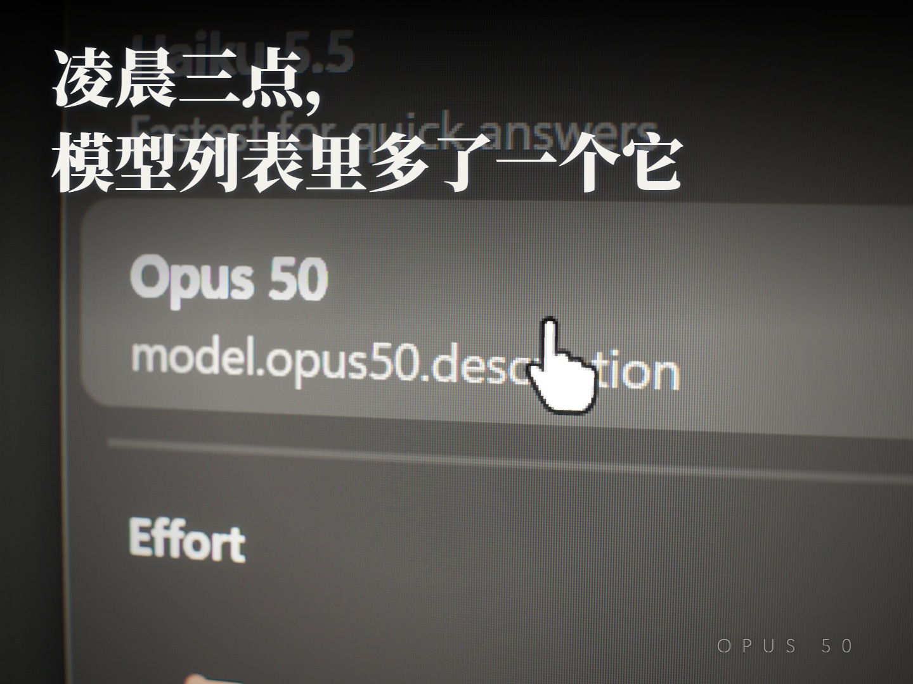
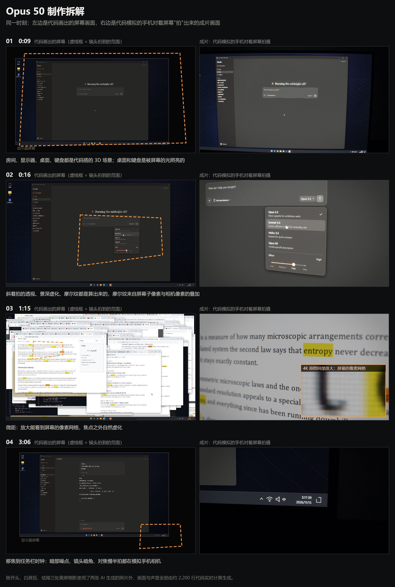

# Opus 50 · 逆熵

一部 3 分 23 秒的伪纪录片式短片：凌晨三点，Claude 桌面端的模型列表里多了一个不该存在的模型「Opus 50」。用户开玩笑地问它怎么逆转熵增，它翻遍了这个时代的互联网，没有找到答案，于是自己算了出来。

整部片子看起来像用手机对着电脑屏幕拍的，但**除了三处黑屏倒影用了两张 AI 生成的照片，其余画面和全部声音都是由约 2,200 行 JavaScript 实时计算生成的**：没有实拍素材，没有素材库，也不需要 3D 软件或视频剪辑软件。



> **声明**：这是一部虚构的同人创作，与 Anthropic 没有任何关联，也没有得到其认可。「Claude」及相关模型名称是 Anthropic 的商标。片中的「Opus 50」模型、对话内容和「逆转熵增」的推导都是虚构的；界面是代码模仿绘制的，不是截图。

## 自己渲染一遍

### 需要什么

- **Windows 10 或 11**：渲染依赖 PowerShell、Edge 和 Windows 自带的 AAC 音频编码器，所以目前只能在 Windows 上运行。
- **Microsoft Edge**：Windows 自带。
- **一块支持 WebGL2 的显卡**：近几年的独立显卡或核显都可以。
- **不需要安装任何其他软件。**

### 一条命令出片

下载（或 `git clone`）整个仓库，在仓库文件夹里打开 PowerShell，运行：

```
powershell -ExecutionPolicy Bypass -File make-video.ps1
```

脚本会依次启动本地服务器、合成配乐、编码音频、逐帧渲染，最后在文件夹里生成 `Opus50_4K.mp4`（3840×2160，约 1.4 GB）。在 RTX 4080 SUPER 上渲染大约需要 2 分钟，显卡越弱越慢。

想先出一个小一点的 1080p 版本：

```
powershell -ExecutionPolicy Bypass -File make-video.ps1 -W 1920
```

如果提示端口被占用，可以换一个端口，比如 `-Port 8777`。

### 会和原片一模一样吗

- 中文衬线字体 Noto Serif SC 已经打包在 `fonts/` 里，不依赖你电脑上有没有装。
- 配乐用固定的随机种子合成，每次结果逐字节一致。
- 少数情况会有细微差别：
  - 等宽小字用的是 Cascadia Mono，它随「Windows 终端」安装，大多数 Windows 11 都有；没有的话会自动换成 Consolas。
  - Windows 10 没有 Segoe UI Variable，界面英文字体会退回 Segoe UI。
  - 不同显卡计算出的画面可能有肉眼看不出的差异。

## 其他用法

先单独启动本地服务器并保持运行：

```
powershell -ExecutionPolicy Bypass -File tools\server.ps1
```

然后用浏览器打开 `http://localhost:8766/` 就能实时预览（空格键播放和暂停，左右方向键快进快退；预览前需要先渲染过一次配乐）。下面这些地址也可以交给 `tools\run-page.ps1` 在后台执行：

| 地址 | 作用 |
| --- | --- |
| `index.html?shots=16,75&scale=.5` | 把指定时刻的画面存成 `out/shots/<秒>.jpg` |
| `index.html?sheet=1,10,20,30&cols=4&name=x` | 把多个时刻拼成一张缩略图 `out/shots/sheet-x.jpg` |
| `index.html?screen=118` | 只输出代码画出的屏幕内容（还没有经过虚拟摄像头） |
| `index.html?compare=9,16,75,186.5` | 生成「原始屏幕 vs 成片」的制作拆解对比图 |
| `index.html?audio=1` | 只合成配乐，生成 `out/audio.wav` |
| `index.html?render=1&w=1920&from=0&to=12` | 只渲染其中一段（由 `tools\render.ps1` 调用） |

例如：

```
powershell -ExecutionPolicy Bypass -File tools\run-page.ps1 -Path "index.html?shots=16,75&scale=.5" -Done "SHOTS DONE"
```

## 它是怎么做出来的



1. **剧本时间表**（`js/story.js`）：每一次点击、每一个按键、每一个字出现的时刻、每一个镜头的位置，都写成精确到毫秒的时间表，画面和声音按同一张表走。
2. **画「屏幕」**（`js/claude.js`、`browser.js`、`screen.js`、`mathtex.js`）：用 Canvas 2D 一笔一笔画出 Windows 桌面、Claude 窗口、15 种网页（7 种语言，文字都是原创的）、公式排版、拼音输入法的候选框和乱码。
3. **虚拟手机拍屏**（`js/camera.js`）：在 WebGL2 里用光线求交搭出显示器、桌子、键盘、杯子组成的 3D 场景，再模拟一台手机去拍它。屏幕的每个像素都拆成红绿蓝三根子像素，**摩尔纹是相机像素和屏幕子像素叠加后自然算出来的**，不是滤镜。景深、运动模糊、卷帘快门、镜头畸变、色差、自动对焦、自动曝光、暗部噪点和屏幕倒影也都是模拟出来的。
4. **声音**（`js/audio.js`）：逐个采样计算。钢琴音按琴弦泛音叠加，弦乐、低音铺底、心跳、谢泼德音阶、风扇、键盘、呼吸声都由振荡器和滤波器合成，混响用合成的空间脉冲做卷积。
5. **编码**（`js/mp4.js`）：用浏览器自带的 H.264 编码器（WebCodecs）压缩，再由手写的 MP4 封装器边渲染边写入文件，内存占用稳定。

## 文件结构

| 路径 | 内容 |
| --- | --- |
| `make-video.ps1` | 一键渲染 |
| `index.html` | 入口：实时预览、截帧、离线渲染、合成配乐 |
| `js/story.js` | 全片时间轴：界面事件、光标、打字（含拼音输入法）、对话内容、浏览器、机位关键帧、测光 |
| `js/claude.js` | 模仿 Claude 桌面端的窗口（深色）、菜单、对话流、推导瀑布、确认卡片 |
| `js/browser.js` | 浏览器窗口和 15 种网页 |
| `js/screen.js` | 桌面、任务栏、光标，以及卡死、撕裂、乱码等故障效果 |
| `js/mathtex.js` | 简易公式排版 |
| `js/camera.js` | 虚拟手机摄像头 |
| `js/audio.js` | 配乐与声音设计 |
| `js/mp4.js` | 流式 MP4 封装 |
| `js/util.js` | 数学、缓动、确定性随机数 |
| `js/main.js` | 各种运行模式 |
| `tools/` | 本地服务器、渲染脚本、AAC 转码、成片检查、声谱图、封面合成 |
| `assets/` | 黑屏倒影照片：`reflect-1.jpg`（开头、白屏后）、`reflect-2.jpg`（结尾），由 AI 生图工具生成；删掉的话会退回代码生成的倒影 |
| `fonts/` | 打包的开源字体 Noto Serif SC 及其许可证 |
| `分镜脚本.md` | 分镜（按实际制作更新过） |
| `生图提示词.md` | 黑屏倒影的生图提示词 |
| `封面/` | 视频封面 |

`tools/cover.html` 用的原图要先截出来：运行 `index.html?shots=25.3,147.5&w=3840&scale=1&tag=cover-src-`。

## 许可证

代码和其余文件使用 [MIT 许可证](LICENSE)。打包的字体 `fonts/NotoSerifSC-VF.ttf` 不属于 MIT 许可证，它使用 SIL Open Font License 1.1，见 [fonts/OFL.txt](fonts/OFL.txt)。
